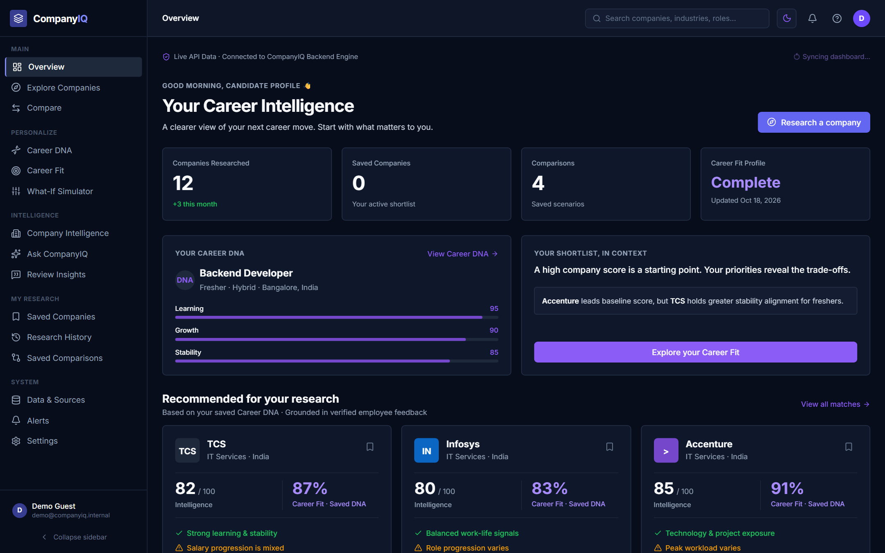
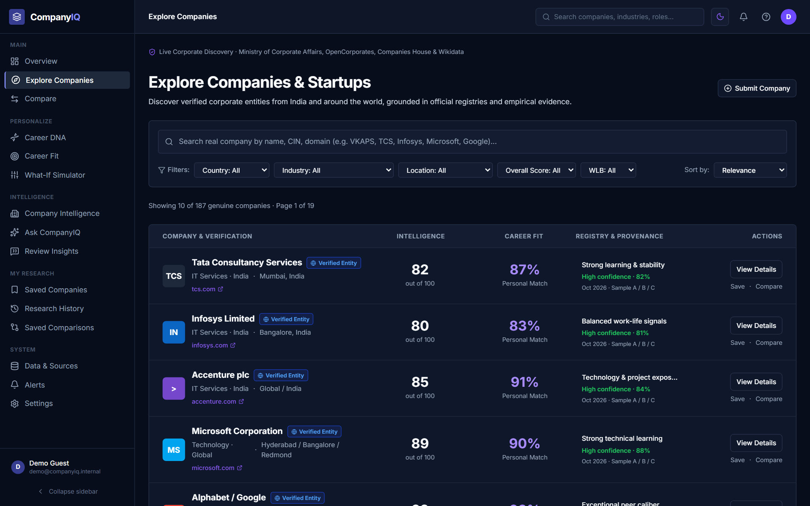
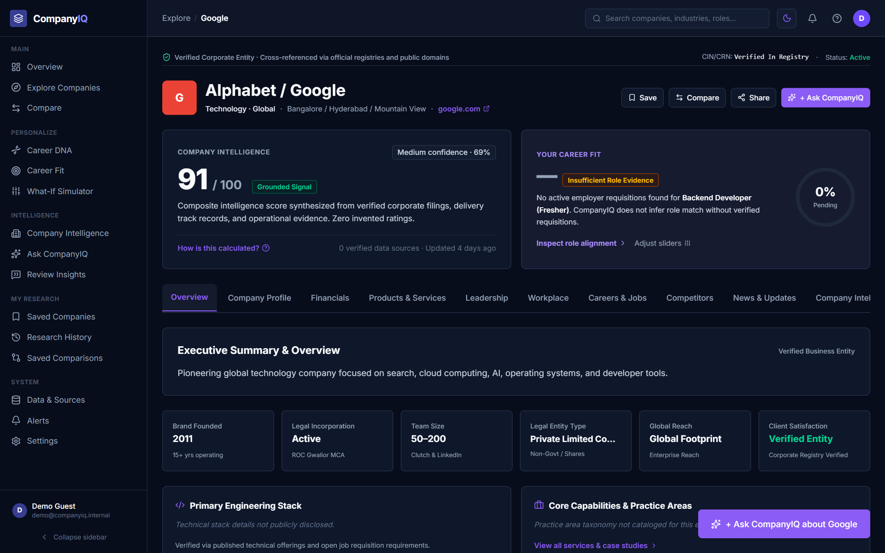
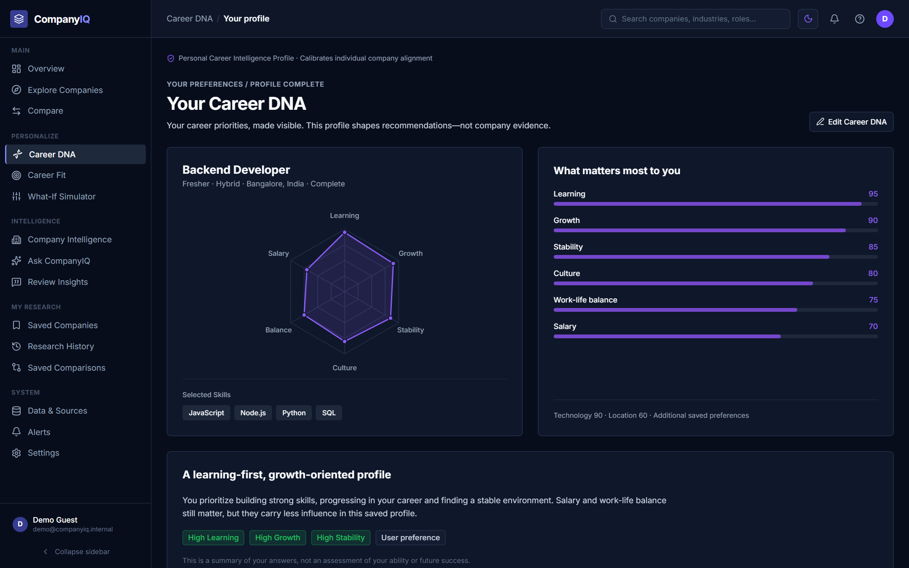
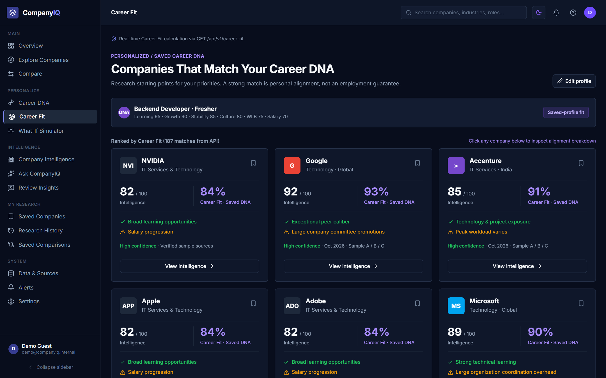
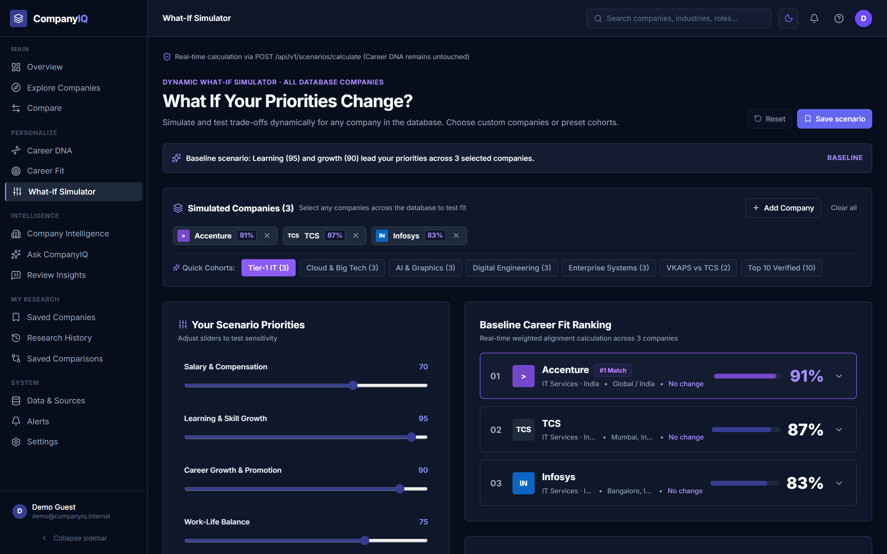
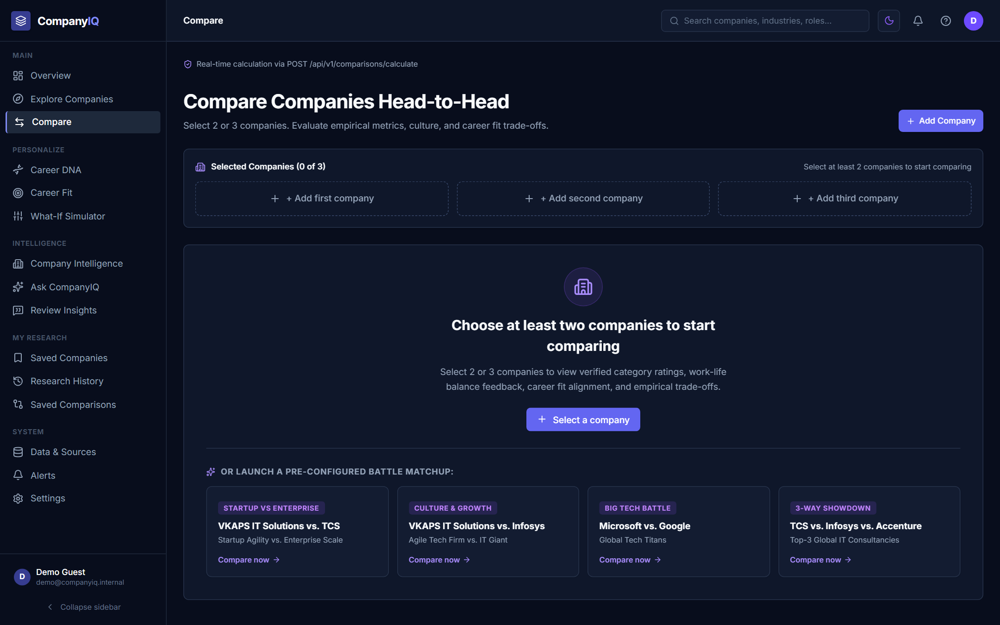
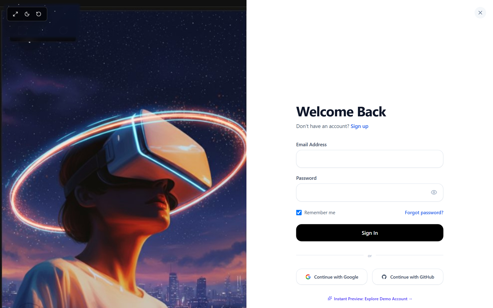
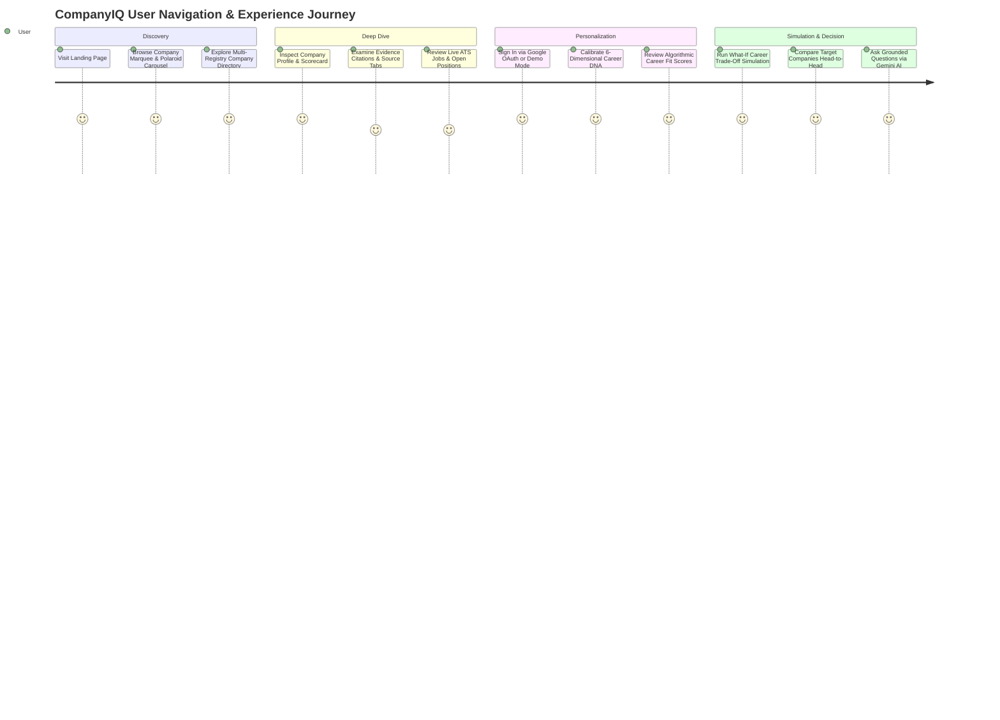

# CompanyIQ — AI-Powered Company Intelligence Platform

<p align="center">
  
</p>

<p align="center">
  <a href="https://react.dev"></a>
  <a href="https://www.typescriptlang.org"></a>
  <a href="https://vitejs.dev"></a>
  <a href="https://tailwindcss.com"></a>
  <a href="https://reactrouter.com"></a>
  <a href="https://lucide.dev"></a>
  <a href="https://vercel.com"></a>
  <a href="LICENSE"></a>
</p>

---

## 🌟 Quick Links

- 🚀 **Live Production Application:** [https://hackathon-2-hariom-jaiswal-frontend.vercel.app/](https://hackathon-2-hariom-jaiswal-frontend.vercel.app/)
- 💻 **Frontend GitHub Repository:** [CompanyIQ-AI-Powered-Company-Intelligence-Platform](https://github.com/hariomjaiswal12/CompanyIQ-AI-Powered-Company-Intelligence-Platform)
- ⚙️ **Backend GitHub Repository:** [CompanyIQ-backend](https://github.com/hariomjaiswal12/CompanyIQ-backend)
- 👨‍💻 **Lead Engineer & UI/UX Designer:** [Hariom Jaiswal](https://github.com/hariomjaiswal12)

---

## Executive Summary & Problem Statement

**CompanyIQ** is a next-generation, evidence-backed company intelligence and career navigation platform. 

### The Problem
Today's candidates, software engineers, and analysts suffer from severe workplace research fragmentation:
- **Glassdoor & AmbitionBox** present subjective 1–5 star ratings without showing verifiable context, recency, or official corporate registration data.
- **Blind & Reddit** contain unfiltered insider discussions that are noisy and difficult to benchmark quantitatively.
- **Levels.fyi** tracks compensation bands but lacks cultural nuance and psychological safety metrics.
- Job seekers struggle to evaluate whether an employer matches their personal priorities (e.g., compensation vs. work-life balance vs. engineering rigor).

### The Solution
CompanyIQ unifies corporate intelligence across multi-jurisdiction registries (India MCA, UK Companies House, OpenCorporates, Wikidata), correlates verified employee signals, and provides an interactive suite of deterministic career navigation tools:
- **6-Dimensional Career DNA Radar**: Personalize career values across key dimensions with real-time reactive radar charts.
- **Deterministic Career Fit Engine**: Algorithmic compatibility scoring with transparent factor-by-factor alignment.
- **What-If Career Simulator**: Real-time sensitivity sandbox to model hypothetical trade-offs without mutating stored user profiles.
- **Head-to-Head Battle Mode Comparison**: Multi-factor company benchmarks with automated category winner highlights.
- **Interactive Halftone Physics Footer & Marquee**: Cyberpunk spatial user experience with HTML5 Canvas physics simulations.

---

## 📸 Production Application Showcase

Here are real, high-resolution captures from the deployed live production application:

<div align="center">

### 1. Executive Intelligence Dashboard & Workspace
*Single-pane telemetry hub consolidating saved employers, live registry provenance, Career DNA summary radar, and market research metrics.*
<br/>


<br/><br/>

### 2. Multi-Registry Company Discovery & Exploration
*Filter and search across hundreds of corporate entities with verified provenance tags (MCA, Companies House, Wikidata), sector chips, and transparent trust indicators.*
<br/>


<br/><br/>

### 3. Evidence-Backed Corporate Deep Dive & Provenance
*Detailed company profile displaying composite intelligence scores (e.g. Google 91/100), transparent category decomposition, verified pros/cons, and direct source attribution.*
<br/>


<br/><br/>

### 4. Interactive 6-Dimensional Career DNA Radar Engine
*Interactive priority customization engine allowing users to calibrate personal weights across Compensation, Culture, Growth, Work-Life Balance, Tech Stack, and Stability.*
<br/>


<br/><br/>

### 5. Deterministic Career Fit Compatibility Engine
*Algorithmic match cards computing mathematical compatibility percentages between user Career DNA and empirical corporate evidence.*
<br/>


<br/><br/>

### 6. Real-Time What-If Sensitivity Simulator
*Transient sandbox modeling the delta impact of hypothetical career compromises (e.g. +30% Compensation vs -20% Work-Life Balance) with zero persistent profile mutation.*
<br/>


<br/><br/>

### 7. Head-to-Head Comparative Intelligence Matrix
*Side-by-side corporate benchmark comparing key metrics, compensation percentiles, leadership approval, and category trade-offs.*
<br/>


<br/><br/>

### 8. Cyberpunk Spatial Glassmorphic Authentication
*High-security authentication gateway featuring dual JWT issuance, Google Identity Services (GIS) verification, Google OAuth 2.0 authorization code exchange, and demo sandbox login.*
<br/>


</div>

---

## User Journey & Interactive Modules



### 1. Public Landing Page & Interactive Physics Footer
- **Tilted Grid Hero**: Dynamic perspective transformation highlighting key metrics and value propositions.
- **Auto-Moving Company Logo Marquee**: Smooth continuous CSS animation moving from left to right across global employer logos.
- **Polaroid Line Carousel**: Interactive horizontal inspection of workplace signal sources (LinkedIn, Glassdoor, AmbitionBox, Levels.fyi).
- **Halftone Wordmark Physics Engine**: Custom HTML5 Canvas particle system simulating cursor repulsion, spring physics return, and click shockwave ripples.

### 2. Multi-Registry Company Discovery (`/explore`)
- Typeahead search with instant debounce and keyboard navigation.
- Sector filters (Cloud, SaaS, FinTech, E-Commerce, Consulting, Semiconductor).
- Verified provenance badges indicating registration authority (India MCA CIN, UK Companies House, Wikidata, OpenCorporates).

### 3. Evidence-Backed Company Intelligence (`/company/:id`)
- Composite scorecard out of 100 broken down across Culture, Leadership, Compensation, Work-Life Balance, and Growth.
- Traceable quotes and employee sentiments linked to source references.
- Missing data safety: metrics with insufficient data are labeled `INSUFFICIENT DATA` instead of defaulting to zero.

### 4. Career DNA Calibration (`/career-dna`)
- Dynamic 6-dimensional radar chart rendered in vector SVG with reactive slider handles.
- Real-time normalization ensuring personal priorities scale evenly across dimensions.

### 5. Career Fit Compatibility Engine (`/career-fit`)
- Deterministic calculation matching user priorities with empirical company attributes.
- Match scorecards highlighting top alignment factors and potential trade-off concerns.

### 6. What-If Career Simulator (`/what-if`)
- Sensitivity sliders that adjust compensation, work-life balance, and learning priorities in memory.
- Instant simulated re-ranking of employers without permanently mutating the user's saved Career DNA.

### 7. Head-to-Head Battle Mode Comparison (`/compare`)
- 2 or 3 company simultaneous comparison grid.
- Pre-configured benchmark templates (e.g. "Startup vs. Enterprise", "TCS vs. Infosys vs. Accenture").
- Radar overlay comparison and category leadership indicators.

---

## Frontend Architecture & Directory Structure

```text
h2frontend/
├── docs/
│   └── screenshots/                     # Production application screenshots
│       ├── 01-dashboard.png
│       ├── 02-company-exploration.png
│       ├── 03-company-details.png
│       ├── 04-career-dna.png
│       ├── 05-career-fit.png
│       ├── 06-what-if-simulator.png
│       ├── 07-company-comparison.png
│       └── 08-authentication.png
├── public/
│   └── images/companyiq/                # Optimized platform graphics
├── src/
│   ├── assets/                          # Static branding & vector artwork
│   ├── components/
│   │   ├── common/                      # Reusable components (ErrorBoundary, ProtectedRoute, CompanyCard)
│   │   ├── landing/                     # Landing sections (CareerDNASection, CompanyMarquee, CompareSection, FeatureShowcase)
│   │   ├── layout/                      # Application shell (Header, Sidebar, MobileNav, AppShell)
│   │   ├── modals/                      # Dialogs (AuthModal, CompanySelectModal, EvidenceDrawer, HowScoreModal)
│   │   └── ui/                          # Custom UI library (Badge, Button, RadarChart, ScoreGauge, halftone-wordmark-footer)
│   ├── context/
│   │   └── AppContext.tsx               # Centralized state (user auth, demo mode, career DNA, saved companies)
│   ├── data/
│   │   └── mockData.ts                  # Development mocks & fallback telemetry
│   ├── lib/
│   │   └── utils.ts                     # Tailwind class merge utility (cn)
│   ├── pages/
│   │   ├── Alerts/                      # Watchlist and metric freshness notifications
│   │   ├── AskCompanyIQ/                # Grounded Gemini AI chat interface
│   │   ├── Auth/                        # Authentication pages & Google OAuth callback handler
│   │   ├── CareerDNA/                   # Radar builder & DNA profile manager
│   │   ├── CareerFit/                   # Deterministic match cards & fit deep dives
│   │   ├── Category/                    # Category deep-dive analysis
│   │   ├── Company/                     # Company intelligence profile & evidence citations
│   │   ├── Compare/                     # Head-to-head battle mode comparison
│   │   ├── Dashboard/                   # Executive overview & workspace telemetry
│   │   ├── Explore/                     # Search & filterable company directory
│   │   ├── History/                     # Research trails & activity log
│   │   ├── Landing/                     # High-impact landing page
│   │   ├── ReviewInsights/              # Sentiment distribution & keyword analysis
│   │   ├── Saved/                       # Shortlisted companies & saved comparisons
│   │   ├── Settings/                    # Account settings, data export & privacy
│   │   ├── Sources/                     # Provenance registry explanations
│   │   └── WhatIf/                      # Real-time sensitivity simulator
│   ├── services/
│   │   ├── apiClient.ts                 # Axios-like fetch client with JWT token injection & error normalization
│   │   ├── aiService.ts                 # Grounded Q&A API integration
│   │   ├── careerService.ts             # Career DNA & Fit scoring API calls
│   │   ├── companyService.ts            # Company search, details, and submissions
│   │   ├── comparisonService.ts         # Side-by-side comparison calls
│   │   └── historyService.ts            # User activity logging
│   ├── types/
│   │   └── index.ts                     # Strict TypeScript interfaces and domain schemas
│   ├── App.tsx                          # Route definitions and workspace shell mapping
│   ├── index.css                        # Tailwind v4 configuration, theme tokens, and animations
│   └── main.tsx                         # React 19 application entry point
├── package.json
├── tsconfig.json
├── vite.config.ts
└── README.md
```

---

## Technology Stack

| Category | Technology | Version | Purpose |
| :--- | :--- | :--- | :--- |
| **Framework** | React | v19.3 | Component-driven UI architecture with modern hooks |
| **Language** | TypeScript | v5.7 | End-to-end type safety and domain modeling |
| **Build Tool** | Vite | v8.3 | Lightning-fast HMR and optimized asset bundling |
| **Styling** | Tailwind CSS | v4.3 | Utility-first responsive styling with custom dark theme tokens |
| **Routing** | React Router | v7.18 | Declarative client-side routing with nested shells |
| **Icons** | Lucide React | v1.63 | Modern, pixel-perfect icon set |
| **Physics / Canvas** | HTML5 Canvas API | Native | Halftone particle simulation with cursor repulsion & shockwaves |
| **Deployment** | Vercel | Production | Global edge hosting with automated CI/CD deployments |

---

## Backend API Integration

The frontend connects to the companion [CompanyIQ Backend API](https://github.com/hariomjaiswal12/CompanyIQ-backend) via a centralized client [`apiClient.ts`](file:///c:/Users/HP/Desktop/h2/h2frontend/src/services/apiClient.ts):

- **JWT Token Management**: Access tokens are stored in memory and synchronized via local storage; automatically injected into `Authorization: Bearer <token>` request headers.
- **Google OAuth 2.0 Integration**:
  - **Google Identity Services (GIS)**: One-click sign-in modal verifying client tokens against Google's JWKS endpoint.
  - **OAuth Authorization Code Flow**: Redirect handler at `/auth/callback` exchanging server codes for authenticated sessions.
- **Instant Demo Mode**: One-click sandbox authentication allowing full feature exploration without requiring email registration.
- **Graceful Offline Fallbacks**: When external API calls are interrupted, deterministic local mocks guarantee unbroken user experience.

---

## Installation & Local Development

### Prerequisites
- **Node.js**: v20.0.0 or higher
- **npm**: v10.0.0 or higher

### 1. Clone the Repository
```bash
git clone https://github.com/hariomjaiswal12/CompanyIQ-AI-Powered-Company-Intelligence-Platform.git
cd CompanyIQ-AI-Powered-Company-Intelligence-Platform
```

### 2. Install Dependencies
```bash
npm install
```

### 3. Configure Environment Variables
Create a `.env` file in the project root:
```env
VITE_API_BASE_URL=http://localhost:5000/api/v1
VITE_GOOGLE_CLIENT_ID=your-google-client-id.apps.googleusercontent.com
```

### 4. Start Development Server
```bash
npm run dev
```
Open [http://localhost:5173](http://localhost:5173) in your browser.

### 5. Production Build
```bash
npm run build
npm run preview
```

---

## Author & Acknowledgments

- **Lead Engineer & UI/UX Designer**: **[Hariom Jaiswal](https://github.com/hariomjaiswal12)**
- **Backend Architecture**: Node.js, Express, MongoDB Atlas, Google Gemini Flash
- **Live Deployment**: Hosted on Vercel at [hackathon-2-hariom-jaiswal-frontend.vercel.app](https://hackathon-2-hariom-jaiswal-frontend.vercel.app/)
- **License**: ISC License — Open for academic, professional, and demonstration use.
